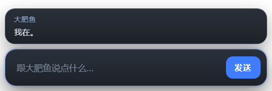

# 桌宠输入窗口

一个独立的小窗口：透明、置顶、无边框、可拖动，默认只有**一个输入框和一个发送键**；
她说话之后，上方会展开一个随内容长高的**返回框**，把她这一轮说出口的话放回来给你看。
它不提供快捷指令，也不提供人格设置——只负责多一个说话的口子。


<sub>真实 Electron 窗口截图（125% DPI）：透明圆角、只有输入框和发送键；发出去之后输入框清空，占位文字短暂变成「说给她了」。</sub>



<sub>她说话后：返回框只占内容高度，不会留一大片透明却挡鼠标的区域；长回复在框内滚动。</sub>

她仍然是 `dsh-fish` 里那只靠经历长大的鱼：你在窗口里说的话，会走设置页
「跟她说一句话」的同一条链路进入她当前的会话，照常经过 `guard.js`、照常进入
「表态 → 撞上 → 落差 → 改写 → 回顾」的成长循环。窗口本身不写事件、不改状态、
不替她说话。

---

## 1. 它怎么启动

不需要单独打开任何程序。`dsh-fish` 插件 `apply()` 时会：

```
插件启动
  └─ lib/index.js 的 boot()
       ├─ lib/pet/index.js  createPet().start()
       │    ├─ lib/pet/bridge.js   起文件通道（生成一次性 token）
       │    └─ lib/pet/electron.js 找 Electron → 拉起 pet/ 小窗
       └─ 其余成长逻辑原样运行
```

窗口进程退出（Alt+F4、任务管理器结束）不会影响插件或她的记忆；下次 DSH 启动会再拉起来。
插件停用或 DSH 退出时，窗口会被一起收掉；Host 意外崩溃时，窗口靠 `--host-pid`
探活自己退出，不会在桌面上留孤儿窗口。

> **真机踩过的坑**：DSH 桌面版的 Host 进程可能**不导出** `DSH_PROFILE=desktop`
> （只有 agent 的 shell 里有）。所以插件不只看 `DSH_PROFILE`，还会看
> `process.versions.electron`、`DSH_PROFILE_DIR`；Windows / macOS 默认按桌面处理。
> 如果日志里出现「桌宠窗口未启用（platform=…, electron=…, DSH_PROFILE=…）」，
> 把这一行发出来就能定位。显式 `DSH_FISH_PET=1` 可以强制打开。

---

## 2. 消息链路

窗口是独立 Electron 进程，拿不到 DSH 面板的登录 cookie，所以不走 HTTP，
而是走 dsh-fish 自己状态库里的文件通道（与 dsh-Ycp 桌宠的思路一致）：

```
pet/ 窗口
  │  输入一句话 + 回车 / 点「发送」
  ▼
<状态库>/pet/request.json          （窗口原子写入，带 bridge token）
  │
  ▼
lib/pet/bridge.js                  （插件内每 700ms 读一次）
  │  ① token 对不上 → 拒
  │  ② normalizePetText() → guard.js：试图重塑人格的话根本不递
  ▼
lib/say.js 的 sayToHer()           ← 设置页 /say 用的也是它
  │  sessionController.prompt({ mode: 'queue' })
  ▼
她屋子里的当前会话                 （普通 user 消息，没有桌宠标记）
  │
  ▼
她照常走自己的成长流程
  │
  ▼
lib/pet/bridge.js 把这一轮她说出口的话写进
<状态库>/pet/messages.json
  │
  ▼
pet/ 窗口轮询 → 上方返回框显示
```

窗口只等两件事：

- **已入队**：`sayToHer()` 在 `prompt()` 返回后回调 `onSent`，窗口回执「说给她了」；
- **没递出**：空话、超长、被 `guard.js` 拦下、屋子没接上，窗口会闪一下红框，把原话留在输入框里。

她的完整对话仍然在 DSH 的会话里；返回框只放她这一轮说出口的话，不做聊天记录面板。
返回框优先显示她在会话里回的 **assistant 文本**；如果这一轮她只通过 `growth_commit`
留下话，就退回 `utterance / revise / reunion / narration / refusal` 这几类。
**日记和留给人的信不会漏进来**；她这一轮没说话时显示一句「她这次没说话。」。

---

## 3. 第一次启动：Electron 从哪来

插件本身**零依赖**，不会往宿主依赖树里加包。桌宠是一个独立 Electron 进程，
按下面的顺序找运行时：

1. 环境变量 `DSH_FISH_ELECTRON` / `DSH_FISH_ELECTRON_PATH` / `ELECTRON_PATH`
2. `<状态库>/electron/electron.exe`（本插件准备的那份）
3. `$DSH_HOME/electron/electron.exe`（装过 dsh-pet 的话直接复用，不重复下载）
4. 都没有 → 后台从镜像下载一次

默认下载 Electron **43.3.0**，ZIP 约 144MB，解压后约 330MB，落在：

```
~/.dsh-fish/electron/electron.exe        # Windows
~/.dsh-fish/electron/Electron.app/...    # macOS
~/.dsh-fish/electron/electron             # Linux
```

下载只在第一次发生，带 SHA256 校验；下载完成后 ZIP 会删掉。
镜像默认是 npmmirror：

```powershell
# 可选：换镜像 / 换版本
$env:DSH_FISH_ELECTRON_MIRROR = "https://npmmirror.com/mirrors/electron/"
$env:DSH_FISH_ELECTRON_VERSION = "43.3.0"

# 可选：直接用已有的 Electron
$env:DSH_FISH_ELECTRON = "C:\path\to\electron.exe"

# 可选：完全不启动这个窗口
$env:DSH_FISH_PET = "0"

# 可选：控制 Chromium OS 沙箱
# Windows 默认关闭（受限会话里会崩）；其他平台默认保留。
# =1 强制保留，=0 强制关闭。
$env:DSH_FISH_PET_SANDBOX = "1"
```

下载期间插件照常启动，她的定时器照常跑；窗口会在准备完成后出现。
被安全软件拦住、公司网络挡了镜像时，窗口不会出现，插件也不会崩——
原因会写进状态库的 `pet/electron.json` 和窗口自己的 `pet/pet-boot.log`。

> **关于 `--no-sandbox`**：Windows 的受限会话里，Chromium 的沙箱 brokerage
> 可能直接以 `platform_channel.cc: 拒绝访问` 崩溃（本机实测）。这个窗口只加载
> 插件自带的本地 HTML，没有远程页面，渲染进程仍然 `contextIsolation: true`、
> `nodeIntegration: false`；因此 **Windows 上**启动参数默认带 `--no-sandbox`
> 换取“能启动”。macOS / Linux 默认保留沙箱；要强制关掉设
> `DSH_FISH_PET_SANDBOX=0`，要强制保留设 `DSH_FISH_PET_SANDBOX=1`。

---

## 4. 加载 / 启动

它没有独立的启动器，是 `dsh-fish` 的一部分，跟着 DSH 一起启动。装法不变：

1. **面板装**：DSH → 设置 → 插件 → 从本地安装 → 选插件目录。
2. **命令行装**（先关 DSH）：

   ```bat
   "<DSH>\resources\runtime\cli\bin\dsh.cmd" plugin --profile <profile> add "link:<插件绝对路径>"
   ```

3. **从 GitHub 装**：

   ```bat
   "<DSH>\resources\runtime\cli\bin\dsh.cmd" plugin --profile <profile> add "github:ssamurias/dsh-fish"
   ```

无论哪种，`package.json` 里的 `files` 都要包含 `pet/` 和 `docs/`（本仓库已经包含）。
装完重启 DSH，桌宠窗口会在插件启动后自动出现。

> **注意**：这份桌宠窗口是本地增量改动，还没有合进上游。请用「从本地安装」或
> `link:<本目录绝对路径>` 指向**改过的这份目录**；`github:ssamurias/dsh-fish`
> 装的是上游版本，没有这个窗口。

**只想要插件、不要窗口**：设 `DSH_FISH_PET=0` 后重启 DSH。
**只想临时关掉窗口**：直接关掉小窗；本次 DSH 运行期间不会再弹，下次启动再出现。

---

## 5. 窗口操作

| 操作 | 结果 |
| --- | --- |
| 拖动小窗空白处 | 移动位置（位置记在 `pet/window.json`，下次启动还原） |
| 拖动返回框 | 同样可以移动（返回框整体是可拖区；内容列表里仍滚动、选字） |
| 输入后按 Enter | 发送 |
| 点「发送」 | 发送；返回框立刻展开显示「她在想…」 |
| 中文输入法选字时按 Enter | 只确认候选，不发送 |
| Esc | 清空输入框 |
| 她说完这一轮 | 返回框里的「她在想…」替换成她的话；长回复在框内滚动，短回复只占内容高度 |
| 拖到屏幕外 | 下次启动会夹回当前屏幕可见区域 |

返回框只显示她**说出口**的话：优先是她在会话里回的 assistant 文本；
她若只通过 `growth_commit` 留下话，就显示 `utterance / revise / reunion / narration / refusal`
这几类。不显示日记、留给人的信，也不显示你的原话。她要是这一轮没开口，会显示一句
「她这次没说话。」，不会拿旧话冒充新回复。

窗口里没有：快捷指令、好感度、性格滑条、亲密度、情绪标签、强制引导按钮。
这是刻意的——她的人格只能从经历里长出来，不能从窗口按钮里长出来。

---

## 6. 文件在哪

全部在状态库（默认 `~/.dsh-fish/`）：

| 路径 | 是什么 | 能不能删 |
| --- | --- | --- |
| `pet/request.json` | 窗口 → 宿主的一句话（瞬时） | 可以，丢了只是这句话没递到 |
| `pet/replies/<id>.json` | 宿主 → 窗口的回执（一条请求一个文件，瞬时） | 可以 |
| `pet/messages.json` | 她这一轮说出口的话（窗口返回框的数据源，最多 40 条） | 可以，删了返回框清空 |
| `pet/bridge.json` | 本次运行的一次性 token | 可以，删了窗口会提示凭证过期 |
| `pet/window.json` | 窗口位置 / pid / 是否 ready | 可以，位置回默认 |
| `pet/status.json` | 宿主记录的窗口状态 | 可以 |
| `pet/electron.json` | Electron 准备状态（成功/失败原因） | 可以 |
| `pet/pet-boot.log` | 窗口进程自己的启动日志（最多 64KB） | 可以 |
| `electron/` | 下载解压出来的 Electron 运行时 | 可以；删了下次启动会重新准备 |
| `events.jsonl` / `state.json` / `diary/` | 她的记忆与日记 | **不能删**（见 README） |

窗口通道不写 `events.jsonl`、不写 `config.json`、不产生新的事件类型。
她和你的每一句话仍然只由 `sayToHer()` / `growth_commit` 那条老链路处理。

---

## 7. 排错

**窗口没出现**

1. 看 `~/.dsh-fish/logs/` 里最新日志：如果写「桌宠窗口未启用」，把后面的
   `platform=…, electron=…, DSH_PROFILE=…` 发出来；也可以先设 `DSH_FISH_PET=1`
   强制打开；
2. 如果没有「桌宠文件通道就绪」，说明插件版本太旧或根本没加载到这一版；
3. 看 `~/.dsh-fish/pet/pet-boot.log` 最后几行，确认窗口进程走到哪一步；
4. 看 `~/.dsh-fish/pet/electron.json` 的 `state` / `error`；
5. 确认 `DSH_FISH_PET` 没有被设成 `0`；
6. 第一次启动可能正在下载 Electron，等下载完成或看日志进度。

如果 `pet-boot.log` 里只有一行 `setPath done` 或什么都没有，通常是 Chromium
沙箱在受限会话里崩了；保持默认的 `--no-sandbox`（或显式 `DSH_FISH_PET_SANDBOX=0`）。

**窗口出现了，但发送没反应**

- 窗口底部闪红框 = 这句没递出去；把鼠标停在输入框上看提示；
- 提示「窗口凭证过期」= DSH Host 重启过，关掉小窗后重启 DSH；
- 提示「她那边还没准备好」= 插件还在启动，等几秒；
- 提示「屋子没接上」= 她的工作区/会话没建起来，去设置 → 大肥鱼看看「她住在哪」。

**发送后连「她在想…」都没有**

1. 输入框清空、占位文字变成「说给她了」，但上方没返回框：说明窗口脚本是旧版，
   在插件管理里把 `dsh-fish` 停用再启用一次（窗口会按当前代码重开）；
2. 输入框没清空、闪红框：这句没递出去，看输入框上的提示。

**一直停在「她在想…」**

1. 她这一轮还没说完（通常几秒到几十秒；她在调工具会更久），不是点了发送就立刻有；
2. 看 `~/.dsh-fish/pet/messages.json` 有没有内容；有内容但窗口没显示，重启一次插件；
3. 看 `~/.dsh-fish/logs/dsh-fish.log` 有没有「桌宠递话结束」；没有说明这一轮还没结束；
4. 她这一轮没开口时，结束后会变成一条灰色「她这次没说话。」，这是正常的。

**下载 Electron 失败**

- 换镜像：`DSH_FISH_ELECTRON_MIRROR`；
- 或手动装一份 Electron，用 `DSH_FISH_ELECTRON` 指过去；
- 或先装 dsh-pet，让它把 Electron 放到 `~/.dsh/electron/`，本插件会直接复用。

**Linux 上窗口是黑底 / 不可拖动**

透明窗口依赖桌面合成器（compositor）。X11 下需要开启 compositing；
Wayland 下由桌面环境决定。窗口逻辑本身不依赖平台，Electron 能起就能用。

---

## 8. 为什么这样设计

- **不碰核心**：`lib/derive.js`、`lib/persona.js`、`lib/store.js` 一行没动。
  窗口只调用已有的 `sayToHer()`，不新增人格计算入口。
- **新输入口必须过 guard**：窗口层先做一次 `normalizePetText()`，
  `sayToHer()` 里还会再做一次；试图重塑人格的话根本不递进去。
- **不写快捷指令**：窗口只有输入框和发送键，避免把「自然长大」变成「按按钮投喂」；
  返回框只显示她说出口的话，不加「今天写日记」之类的任务入口。
- **返回框不偷看私密内容**：优先 assistant 文本，退回 `HER_TYPES`；
  日记和留给人的信不会进 `messages.json`。
- **普通消息**：窗口不往消息里加「来自桌宠」之类的标记；她收到的是和你从设置页
  说话时一样的 user 消息。
- **零依赖**：Electron 是独立运行时，不进 `dependencies`；ZIP 解压用内置
  `node:zlib`，下载用内置 `fetch`，SHA256 用内置 `node:crypto`。
- **可停用**：`DSH_FISH_PET=0` 一行就关；停用插件时窗口进程一起收掉。

---

## 9. 测试

新增 `test/pet.test.mjs`（23 条）覆盖：开关矩阵、Electron 查找/复用、ZIP 解压
（store + deflate + 路径穿越拒绝）、文件通道（正常/guard 拦截/token 失效/失败回执/
连续两句回执不互相覆盖）、**返回框（assistant 优先、她的话进 messages.json、日记不漏、
没说话留 note）**、「只调用 sayToHer、不自己写事件」的静态约束、
窗口文案与「只有一个发送按钮」、透明置顶无边框参数、零依赖。

全量 `node --test --test-isolation=none` = **625 tests / 622 pass / 3 fail**，
三条仍是已知环境/跨文件假红（`detectFfmpeg` 的 spawn EPERM、`cover` 的 fetch、`ULID`）。

```bash
# 单跑桌宠测试
node --test --test-isolation=none test/pet.test.mjs

# 全量（本机受限环境；正常环境可直接 node --test）
node --test --test-isolation=none
```

`lib/say.js` 只多了一个可选的 `onSent` 回调（不传时行为完全不变），
`test/p3.test.mjs` 里有一条测试钉住它：回调必须在 `prompt()` 之后触发。
